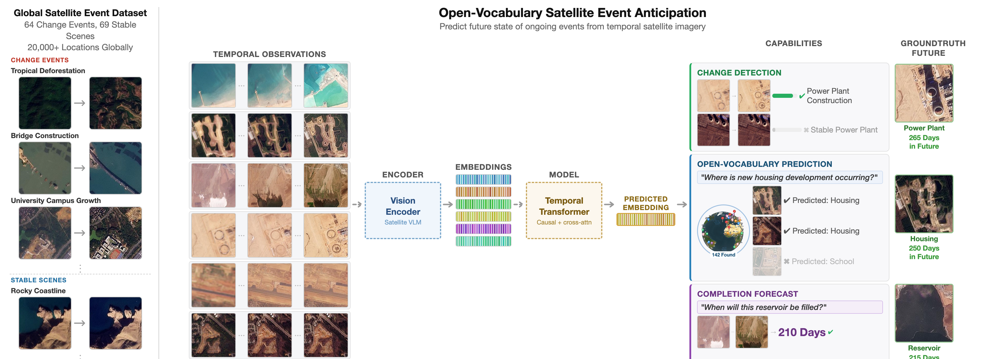
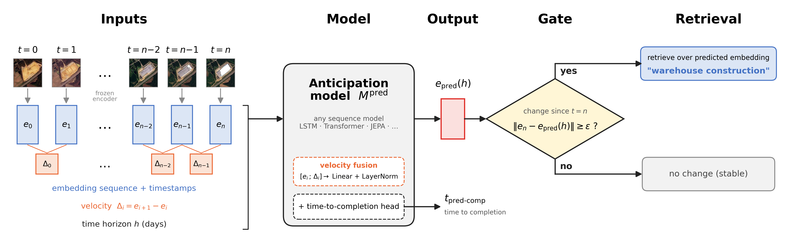

# Predicting the Needle in a Petabyte Scale Haystack

<a href="https://neurips.cc/"></a> **NeurIPS 2026**

Predict what a location will look like when an ongoing event completes, from a sequence of
satellite image embeddings, then retrieve the event by text description.

**Official website:** https://www.cs.cornell.edu/~revankar/predicting-the-needle





## 1. Set up

```bash
git clone https://github.com/ShreelekhaR/predicting-the-needle.git
cd predicting-the-needle
conda create -n anticipation python=3.11 -y
conda activate anticipation
pip install -r requirements.txt
python -m scripts.test_env       # checks packages, GPU, a training step, checkpoints and data
```

If it reports the NVIDIA driver is too old (CUDA 12.4 drivers):
`pip install "torch==2.1.2" "numpy<2" --index-url https://download.pytorch.org/whl/cu121`

Run every command from the repo root.

## 2. Download data and checkpoints

_Link will be added after the permitted release date (early 2027)._

```
data/embeddings/   weekly image embeddings per location ({ps,s2}_{rssiglip,remoteclipft}_*)
data/              labels, text embeddings, completion dates, test sets
checkpoints/       ps_rssiglip, ps_rssiglip_wo_vel, ps_remoteclipft, s2_rssiglip, s2_remoteclipft
```

## 3. Build the training set

```bash
python -m scripts.build_dataset --sensor ps --output data/train.pt
```

## 4. Train

```bash
python -m scripts.train --experiment B_learn_after_diffs --dataset data/train.pt \
    --results-dir results --predict-time --epochs 200
```

`B_learn_after` trains the model without velocity. A checkpoint is saved every epoch.

## 5. Evaluate

```bash
python -m scripts.sweep_checkpoints --results-dir results --experiment B_learn_after_diffs \
    --dataset data/test.pt --text-emb data/text_rssiglip.json
python -m scripts.eval_time_to_completion --model checkpoints/ps_rssiglip_anticipation.pt --dataset data/test.pt
```

For RemoteCLIP or Sentinel-2, use the matching test set (`test_remoteclip.pt`, `test_s2.pt`,
`test_remoteclip_s2.pt`) and `data/text_remoteclipft.json` for RemoteCLIP.

## License

**Code:** Apache License 2.0 (see `LICENSE`).

**Data and model checkpoints:** CC BY-NC-SA 4.0 (non-commercial). Imagery © Planet Labs PBC.
